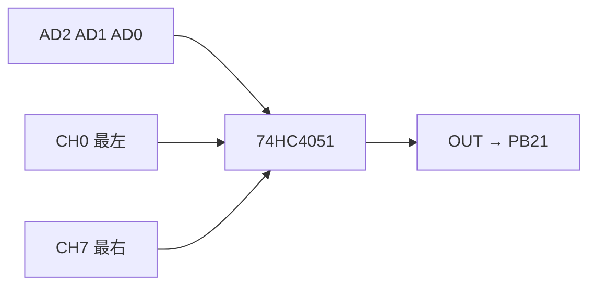

# 03 循迹

> **本篇目标**：读出 8 路灰度传感器的状态，算出偏差值，让小车跟着黑线走。
> **前置**：完成 [02 电机](02-motor.md)。
> **验收标准**：黑线放在传感器左侧，偏差为负；右侧为正；小车能沿黑线前进并自动修正。

## 硬件

| 信号 | 引脚 | 说明 |
| --- | --- | --- |
| AD0 | PA30 | 通道选择最低位 |
| AD1 | PB0 | 通道选择 |
| AD2 | PB1 | 通道选择最高位 |
| OUT | PB21 | 输出，1 = 检测到黑线 |

8 路探头不是同时输出的，而是通过 **74HC4051 八选一模拟开关**轮流选通：



给 AD2~AD0 三个引脚一个 3 位二进制数，就把对应的那一路接到 OUT。

## 原理：从 8 个探头到 1 个偏差

扫描一圈拿到 8 个 0/1，再乘以权重求和，就得到「线偏离中间多少」：

| 通道 | CH0 | CH1 | CH2 | CH3 | CH4 | CH5 | CH6 | CH7 |
| --- | --- | --- | --- | --- | --- | --- | --- | --- |
| 位置 | 最左 | | | | | | | 最右 |
| 权重 | −7 | −5 | −3 | −1 | +1 | +3 | +5 | +7 |

- 线在正中间 → CH3/CH4 压线 → 权重约 0
- 线在左边 → CH0 压线 → 偏差 −7
- 一路都没检测到 → 返回 `TRACE_LOST`

**为什么要加权**：如果只数「左边几个亮」，就无法区分「稍微偏左」和「偏到最左」。权重让偏差连续可分。

## 代码

```c
#include "ti_msp_dl_config.h"
#include "trace.h"
#include "motor.h"

#define RUN_SPEED  (100)
#define TURN_GAIN  (90)

int main(void)
{
    SYSCFG_DL_init();
    motor_init();

    while (1) {
        int16_t error = trace_error();      /* -7 ~ +7，或 TRACE_LOST */

        if (error == TRACE_LOST) {
            motor_stop_all();               /* 丢线先停车 */
        } else {
            int16_t diff = error * TURN_GAIN;
            /* 误差为正（线在右）→ 左轮加速、右轮减速 → 向右修正 */
            motor_drive(RUN_SPEED + diff, RUN_SPEED - diff);
        }
        delay_cycles(32000 * 10);           /* 10 ms 一轮 */
    }
}
```

## 关键参数

| 宏 | 值 | 说明 |
| --- | --- | --- |
| `TRACE_ACTIVE_LEVEL` | 1 | 检测到黑线时 OUT 的电平 |
| `TRACE_SETTLE_CYCLES` | 64 | 切换通道后的等待拍数，等信号稳定 |
| `RUN_SPEED` | 100 | 直行基础速度 |
| `TURN_GAIN` | 90 | 偏差 1 格对应的差速 |

## 验收

| 检查 | 通过标准 |
| --- | --- |
| 单路读数 | 用黑卡纸依次靠近 8 个探头，只有对应通道变 1 |
| 方向 | 黑纸放最左，`trace_error()` 返回 −7 |
| 循迹 | 小车能沿黑线走，弯道自动修正 |
| 丢线 | 把车拿离黑线，0.5 秒内自动停车 |

## 常见问题

| 现象 | 原因 |
| --- | --- |
| 8 路读数全一样 | AD0/AD1/AD2 接线错，或 `TRACE_SETTLE_CYCLES` 太小 |
| 偏差方向相反 | 探头装反了，把权重数组反过来，或调换 `motor_drive` 两个参数 |
| 车在线上左右摆 | `TURN_GAIN` 太大，降到 50~70 试 |
| 转弯时冲出线 | `RUN_SPEED` 太快，先降到 80 |

## 下一步

[04 蓝牙遥控](04-bluetooth.md) —— 用手机手动开车。
