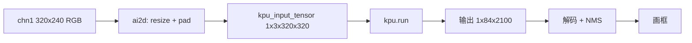

# 06 YOLO 识别钢球

> **本篇目标**：画面里的钢球被绿色框标出，并显示置信度和面积。
> **前置**：完成 [05 摄像头](05-camera.md)。
> **验收标准**：IDE 预览里钢球被绿框套住，框上方显示 `0.xx 面积`，帧率 10 fps 以上。

## 硬件与模型

| 项目 | 说明 |
| --- | --- |
| 模型 | `yolo11n_det_320.kmodel`（YOLO11n，输入 320×320，单类别钢球） |
| 存放路径 | 板子 `/sdcard/yolo11n_det_320.kmodel` |
| 输出 | `[1, 4+nc, N]`，320 输入时 N = 2100 |

> 模型被 `.gitignore` 排除，需要自行下载后拷到 K230 的 SD 卡根目录。

## 推理链路



四个环节，缺一不可：

| 环节 | 作用 |
| --- | --- |
| `ai2d` | 把 320×240 缩放并补边到 320×320（letterbox） |
| `kpu` | 执行 kmodel 推理 |
| 解码 | 从 2100 个候选里筛出置信度够的框 |
| NMS | 去掉重叠框，一个球只留一个框 |

## 关键代码

### 1. 预处理：letterbox

```python
top, bottom, left, right, ratio = letterbox_pad_param([AI_WIDTH, AI_HEIGHT], model_size)

ai2d = nn.ai2d()
ai2d.set_dtype(nn.ai2d_format.NCHW_FMT, nn.ai2d_format.NCHW_FMT, np.uint8, np.uint8)
ai2d.set_pad_param(True, [0, 0, 0, 0, top, bottom, left, right], 0, [128, 128, 128])
ai2d.set_resize_param(True, nn.interp_method.tf_bilinear, nn.interp_mode.half_pixel)
ai2d_builder = ai2d.build([1, 3, AI_HEIGHT, AI_WIDTH], [1, 3, model_size[1], model_size[0]])
```

**注意**：numpy 的尺寸顺序是 `[宽, 高]`，而张量是 `[高, 宽]`，所以写 `model_size[1], model_size[0]`。写反了推理不会报错，但框全错。

本工程 320×240 → 320×320，`ratio = 1.0`、`top = left = 0`，所以**坐标不需要换算**，可以直接用。

### 2. 推理

```python
kpu = nn.kpu()
kpu.load_kmodel("/sdcard/yolo11n_det_320.kmodel")

img = sensor.snapshot(chn=CAM_CHN_ID_1)
ai2d_builder.run(nn.from_numpy(img.to_numpy_ref()), kpu_input_tensor)
kpu.set_input_tensor(0, kpu_input_tensor)
kpu.run()
out = kpu.get_output_tensor(0).to_numpy()
```

### 3. 解码

YOLO11 的输出是 `[1, 4+nc, N]`，要先转置成 `[N, 4+nc]` 再逐行处理：

```python
def decode_boxes(out, ratio, top, left, conf_thres=0.6):
    if len(out.shape) == 3:
        out = out[0]
    if out.shape[0] < out.shape[1]:
        out = out.transpose()
    n, c = out.shape
    boxes = []
    for i in range(n):
        score = float(np.max(out[i][4:]))     # 类别分数，无 objectness
        if score < conf_thres:
            continue
        cx, cy, w, h = out[i, 0], out[i, 1], out[i, 2], out[i, 3]
        boxes.append(((cx - w/2 - left)/ratio, (cy - h/2 - top)/ratio,
                      (cx + w/2 - left)/ratio, (cy + h/2 - top)/ratio, score))
    return boxes
```

**与 YOLOv5 的区别**：YOLOv8/v11 **没有 objectness 通道**，`out[i][4:]` 直接就是各类别分数，取 `max` 即可。

### 4. 选最佳目标

一帧可能有多个框（反光、误检）。本工程取**面积最大**的那个——离得最近的球：

```python
if area > best_area:
    best_area = area
    best = (x1, y1, x2, y2)
```

## 验收

| 检查 | 通过标准 |
| --- | --- |
| 模型加载 | 终端无 `load_kmodel` 报错 |
| 输出形状 | 打印 `out shape = (1, 84, 2100)` |
| 检测 | 钢球被红框套住，最佳目标额外有绿框 |
| 分数 | 框上方置信度 > 0.6 |
| 帧率 | 10 fps 以上 |

## 常见问题

| 现象 | 原因 |
| --- | --- |
| `load_kmodel` 失败 | 模型不在 `/sdcard/`，或文件名拼错 |
| 输入全黑 | chn1 没设置 `RGBP888`，或 `sensor.run()` 前没 `MediaManager.init()` |
| 框位置偏移 | `ai2d.build` 的宽高写反，或 `ratio/top/left` 没参与换算 |
| 一个球出多个框 | `nms` 没调用，或 `iou_thres` 太低 |
| 帧率很低 | `to_ide=True` 没关；或 `_set_chn_fps` 限制太低 |

## 下一步

[07 串口协议](07-uart.md) —— 把检测结果传给 MSPM0。
