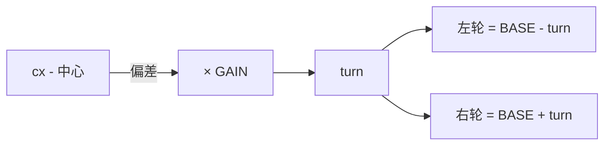

# 08 视觉追踪联调

> **本篇目标**：小车一边前进一边转向，追着钢球跑；靠近后自动停车。
> **前置**：完成 [07 串口协议](07-uart.md)。
> **验收标准**：球在左边车向左追，球在右边车向右追，贴近后停车，丢球 300 ms 内停车。

## 核心难点：两个时间尺度

| 环节 | 周期 |
| --- | --- |
| K230 视觉帧 | 约 70 ms（14 fps） |
| MSPM0 控制循环 | 10 ms |

**1 帧视觉数据要撑 7 圈控制循环。** 如果每圈都把 `found` 重新初始化为 0，那 6/7 的时间都在执行 `motor_stop_all()`——车只会抽动，不会前进。

### 解法：状态跨周期保持 + 超时

```c
/* main 顶部，跨循环保持 */
uint8_t  cv_found = 0;
uint16_t cv_cx    = VISION_CENTER_X;
uint16_t cv_area  = 0;
int      cv_lost_ms = 0;
```

```c
while (k230_read_frame(payload, &len)) {
    if (len >= 7) {
        cv_found = payload[0];            /* 更新而不是重置 */
        cv_cx    = ...;
        cv_area  = ...;
        got      = 1;
    }
}

if (got) {
    cv_lost_ms = 0;                       /* 收到帧，计时清零 */
} else {
    cv_lost_ms += LOOP_MS;
    if (cv_lost_ms >= 300) {              /* 300 ms 没帧才算丢目标 */
        cv_found = 0;
    }
}
```

**为什么是 300 ms**：视觉 70 ms 一帧，留 4 倍余量容忍偶发卡顿；再长就会出现「球已经走了车还在追旧坐标」。

## 差速追踪

只有两个轮子独立控制，就能同时实现「前进」和「转向」：

```
左轮 = 基础速度 + 转向修正
右轮 = 基础速度 - 转向修正
```



| 球的位置 | err | turn | 左轮 | 右轮 | 行为 |
| --- | --- | --- | --- | --- | --- |
| 正中 | 0 | 0 | 150 | 150 | 直行 |
| 偏左 cx=100 | −60 | 60 | 90 | 210 | 边前进边左转 |
| 最左 cx=20 | −140 | 300 | −150 | 450 | 左轮反转，原地转 |
| 偏右 cx=220 | +60 | 60 | 210 | 90 | 边前进边右转 |

当 `turn > BASE` 时，内侧轮变负数，车从「边走边转」自然过渡到「原地转」。

## 用面积判断远近

`area` 是框的像素面积，球越近面积越大：

| 面积 | 判断 | 动作 |
| --- | --- | --- |
| < 200 | 太小，可能是误检 | 视为未找到 |
| 200 ~ 6000 | 正常追踪范围 | 前进 + 转向 |
| ≥ 6000 | 已贴近 | 停车 |

**阈值怎么定**：看 K230 画面上框旁边显示的面积数字，量一下「想停下来的距离」对应的面积，填进 `VISION_STOP_AREA`。

## 完整控制段

```c
if (cv_found && cv_area >= VISION_MIN_AREA) {
    int16_t err = (int16_t)((int16_t)cv_cx - VISION_CENTER_X);
    int16_t mag = (err < 0) ? (int16_t)(-err) : err;
    int16_t turn;
    int16_t left;
    int16_t right;

    if (cv_area >= VISION_STOP_AREA) {
        motor_stop_all();
    } else {
        turn = 0;
        if (mag > VISION_DEAD_X) {                      /* 死区内只直行 */
            turn = (int16_t)((mag - VISION_DEAD_X) * VISION_GAIN);
            if (turn > VISION_MAX_TURN) { turn = VISION_MAX_TURN; }
        }

        left  = VISION_BASE_SPEED;
        right = VISION_BASE_SPEED;
        if (err < 0) { left -= turn; right += turn; }    /* 球在左 */
        else         { left += turn; right -= turn; }    /* 球在右 */

        motor_drive(left, right);
    }
} else {
    motor_stop_all();
}
```

## 调参顺序

**不要一次改多个参数**，按这个顺序调：

| 步骤 | 参数 | 现象与调整 |
| --- | --- | --- |
| 1 | `VISION_BASE_SPEED` | 太快冲过头就降；太慢追不上就升（默认 150） |
| 2 | `VISION_GAIN` | 转弯跟不上球 → 升到 4~5；左右摆 → 降到 2 |
| 3 | `VISION_STOP_AREA` | 还没靠近就停 → 调大；顶到球还在冲 → 调小 |
| 4 | `VISION_DEAD_X` | 直线行驶时来回微调 → 加大到 50~60 |

**左右摆的根因**：增益太大 + 视觉延迟 70 ms，形成「过冲—反过冲」的极限环。降低 `VISION_GAIN` 或减小 `VISION_MAX_TURN` 都能压住。

## 验收

| 检查 | 通过标准 |
| --- | --- |
| 按键 | 按 KEY3 进入视觉追踪 |
| 直行 | 球放正前方，车直线前进 |
| 左偏 | 球移到左侧，车向左追 |
| 右偏 | 球移到右侧，车向右追 |
| 近停 | 球贴近到设定距离，车停下 |
| 丢球 | 拿走球，300 ms 内停车 |
| 无抖动 | 直线追踪时车身不左右摆动 |

## 常见问题

| 现象 | 原因 |
| --- | --- |
| 车完全不动 | 没按 KEY3；或视觉状态每轮被清零；或 `VISION_MIN_AREA` 太大 |
| 球在正中却一直转 | `VISION_CENTER_X` 与实际画面宽度不符（320 宽应为 160） |
| 转向相反 | 摄像头镜像后 `cx` 左右反了，交换 `left/right` 的加减方向 |
| 一冲一停 | 视觉帧间隔大于控制周期且状态没保持，见本篇开头 |
| 追到球附近左右猛打 | `VISION_STOP_AREA` 没设或太大，车进入极近距离后扭矩过剩 |

## 完成

到这里整条链路已经跑通：

```
OV5647 → K230 YOLO → 11 字节串口 → MSPM0 状态机 → 差速控制 → TB6612 → 四轮
```

回到 [教程目录](README.md) 可以按需查阅其他篇目。
