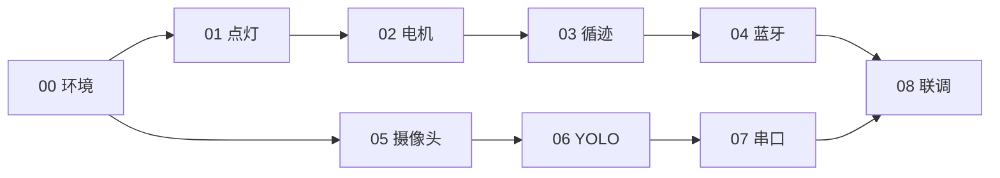

# 分步教程

从零复刻这台钢球追踪小车。**按顺序做，每篇末尾都有验收标准，通过了再进入下一篇。**

## 学习路径

00~04 是 MSPM0 侧的基础（建议全做），05~07 是 K230 侧与通信，08 是两条线合流。

## 篇目

| 篇 | 内容 | 前置 | 验收标准 |
| --- | --- | --- | --- |
| [00 环境搭建](00-environment.md) | CCS + SDK + CanMV IDE | — | 能编译、K230 能打印 hello |
| [01 点灯](01-led.md) | GPIO 输出 | 00 | LED4 1 Hz 闪烁 |
| [02 电机](02-motor.md) | TB6612 + PWM | 01 | 四轮正反转、差速正确 |
| [03 循迹](03-trace.md) | 74HC4051 八选一 | 02 | 偏差 −7 ~ +7，能沿线走 |
| [04 蓝牙遥控](04-bluetooth.md) | UART1 单字节协议 | 03 | 手机发 W/A/S/D 有响应 |
| [05 摄像头](05-camera.md) | Sensor 双通道 + Display | 00 | IDE 看到实时画面 |
| [06 YOLO](06-yolo.md) | ai2d + KPU 推理 | 05 | 钢球被绿框套住 |
| [07 串口协议](07-uart.md) | 11 字节帧 + 环形缓冲 | 01 / 06 | MSPM0 LED4 随帧闪 |
| [08 联调](08-tracking.md) | 差速追踪 + 时序解耦 | 04 / 07 | 车边跑边追球 |

## 时间和难度

| 篇 | 难度 | 卡点 |
| --- | --- | --- |
| 00~02 | 低 | 环境变量、调试器驱动 |
| 03~04 | 低 | 接线顺序、波特率 |
| 05~06 | 中 | 显示初始化顺序、模型路径 |
| 07 | 中高 | 串口共地、中断排空 |
| 08 | 高 | 时序解耦、参数整定 |

## 整机常见问题

| 现象 | 先查 |
| --- | --- |
| 烧录报 -1001 / -2064 | SWD 接线、目标板供电 |
| K230 黑屏 | `bind_layer` 是否在 `Display.init` 之前 |
| 串口数据乱 | 两边波特率、GND 是否共地 |
| 车不动 | 是否按了对应功能键（KEY1 循迹 / KEY2 蓝牙 / KEY3 视觉） |
| 车抽动不前进 | 视觉状态是否跨控制周期保持 |
| 转向反了 | 摄像头镜像后坐标方向变化 |

## 相关文档

- [硬件资料](../README.md)：原理图、PCB 布局
- [项目主页](../../README.md)：系统架构、协议定义、可调参数总表
